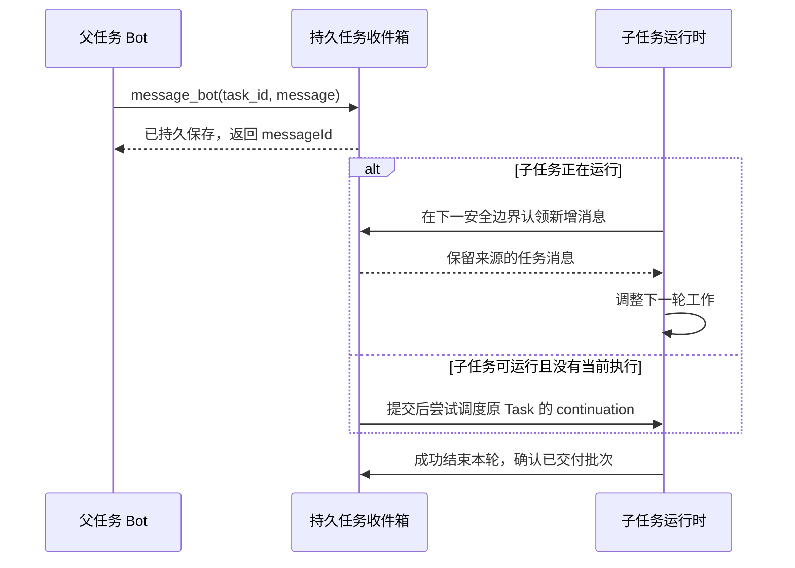

# 父子任务后续改造方案：运行中收件、进展汇报与重复派发

状态：已在本地 `dev` 实现并完成回归与独立源码复审，尚未部署。日期：2026-10-21。实现基线：`7bbea150`。

本文承接 [第一阶段方案](./bot-coordination-phase-one.md)。以下保留设计依据与验收契约；第 10 节记录本次实现、验证及发布边界。

## 1. 目标与范围

1. 子 Bot 在同一 Run 内及时接收 Chief 的补充要求，Chief 也能在运行中接收子任务问题和结果。
2. 长任务有明确的汇报节奏，区分实质进展、运行存活和等待状态，避免静默数小时，也避免反复唤醒 Chief。
3. 旧任务尚未结束时，默认补充原任务；独立工作和终态返修显式创建新任务，防止重复派发。

保留第一阶段约束：私聊 `coordination_v1`、同一用户与 Space 隔离、0..N 个 Chief、普通 Bot 可分解自己的任务、父任务持续存在、不恢复交互次数上限。Chief 是否检查质量仍由用户要求决定，不增加强制验收状态机。群聊与旧协议保持原路径。

## 2. 源码审核结论

| 问题 | 基线存在的行为 | 可以复用的基础 | 必须补齐 |
| --- | --- | --- | --- |
| 运行中指令延迟 | `taskRunContext` 只在 Run 启动加载任务收件箱 | 用户 steering 的模型轮次安全边界、TaskMessage、任务树锁与 lease fence | 独立任务消息通道、最终退出前收件、长 shell 等待可唤醒 |
| 汇报无明确频率 | `message_bot` 由模型主动调用，无任务级报告时钟；任何未读消息都可能唤醒父任务 | 30 秒 reconciler、工具完成审计、既有消息交付 | 任务级报告期限、状态合并、关键事件即时通知、终态与普通进展分离 |
| 重复派发 | `delegationKey` 只防同一工具操作重放，不防后续主动重复调用 | 事务、父子关系、children 快照、取消清理 outbox | 活跃子任务冲突检查、稳定工作标识、明确独立工作与修订语义 |

关键源码定位（以基线为准）：

- `packages/db/src/task-coordination.ts`：`delegateTask`、`sendTaskMessage`、`taskRunContext`、`createContinuation`、`finishCoordinatedTask`、`reconcileTaskContinuations`。
- `packages/adapters/src/task-tools.ts`：派发、消息、查询及取消工具入口。
- `packages/adapters/src/executor.ts`：任务上下文加载、工具路由、runtime 接线、结束后调度。
- `packages/adapters/src/pi-runtime.ts`：`prepareNextTurnWithContext`、`finishTurn`。
- `packages/adapters/src/shell-command-stream.ts`：后台 shell 跟踪与完成等待。
- `packages/adapters/src/job-reconciler.ts`：默认 30 秒恢复扫描。
- `packages/db/src/events.ts`：用户 steering 的认领、事件审计与 Run 终结。
- `packages/adapters/src/user-progress.ts`：面向用户的进展预算，不是父子任务汇报策略。
- `packages/core/src/approval-effect-key.ts`：工具操作幂等键含调用次数，不能代替业务工作标识。

现有用户进展的“运行满 60 秒、每 Run 最多 3 条”和 executor 的续租心跳，都不能直接当作子任务汇报策略。前者面向用户，后者仅证明执行者存活。

## 3. 运行中及时收件

### 3.1 投递与处理流程

“已保存”“已交付给运行时”“已处理”必须区分。工具返回成功只表示可靠保存；不能把 claim 或模型看到消息等同于已经执行要求。

### 3.2 复用边界，独立保留来源

- 新增任务收件认领入口，例如 `claimTaskInbox(runScope, seenMessageIds)`；初始上下文与运行中收件复用同一批次语义。
- 在 provider-neutral runtime 契约增加独立任务消息回调，复用 Pi 的安全边界。不要把 Bot 消息插入人类 `SteeringMessage` 表，或标成 `Additional user context`。
- 消息携带 ID、发送任务、发送 Bot、类型、回复关系及正文；作为任务工作数据处理，不获得新的用户授权。Chief 角色不能提升消息本身的授权级别。
- 初始加载返回已经交付的消息 ID，作为运行时去重集合。后续只注入增量，不反复复制整个原始任务与收件箱。
- 有相关结果/派发变化时刷新必要的子任务状态摘要，供 Chief 判断任务是否仍开放；不要每个工具边界注入完整任务树。
- 同一 Task 双向适用；其他 Chief、同 Bot 的其他 Task、兄弟 Task 不因共用线程而获得收件权限。

三个必需的接收时点：

1. Run 启动时。
2. 下一次模型请求前的安全边界，包括工具批次返回后。
3. `finishTurn` 最终退出前；若有需处理消息，安排同 Run 下一轮，不直接结束。

只接第 2 点不完整：无工具的最终回复之后可能不会再有下一次准备钩子。最终检查之后仍有入信竞态，必须保留数据库 finalization 的待处理消息检查与 continuation 兜底。

### 3.3 长工具、后台 shell 与响应承诺

当前 `finishTurn` 会等待后台 shell 退出。需要把这段等待改为可因新任务消息或报告期限到达而让出，保留所有未结束 shell 的跟踪和最终输出；不能提前移除 promise、遗失退出结果，或重复执行命令。

- 后台 shell 仍在运行时，可以先让模型处理新指令；上下文明确列出该命令仍未结束。
- 若新动作会与旧命令冲突，必须先走现有取消/停止并确认释放，再启动冲突动作。收到补充指令不自动杀进程。
- 普通同步工具和单次模型请求以返回为安全边界；本期不为任意第三方工具新增强制抢占。
- 控制消息不得启动同一 Task 的第二个并行模型 Run。等待人工批准、接管时持久排队，不自动绕过等待。

验收承诺是“下一安全边界可见”，不能宣称所有指令固定几秒内执行。后台 shell 等待阶段复用等待循环并加入独立的收件唤醒信号，建议检查间隔不超过 2 秒；这是调度检测目标，不是端到端模型响应保证。收件唤醒与 Run 取消使用不同信号，不能触发现有 Run AbortSignal 来实现让出，否则会终止 agent 或工具。普通长调用未返回时，记录真实延迟与状态。

### 3.4 可靠性和权限

- 认领遵守线程锁 → 任务树锁；校验 task/user/space/bot/thread、活动状态及 lease fence。
- claim 不等于消费。成功 finalization 只消费实际交付的批次；未回答问题保留，必须用 `reply_to` 回答。
- 同一运行尝试内不重复注入；崩溃恢复允许未确认消息重放，保证至少一次交付，不承诺外部副作用恰好一次。
- 同 Run 恢复可重读已有 claim。若实现需要换 Run，必须同时迁移或释放旧 claim，不能只换 Run ID。
- 记录轻量任务消息交付事件用于诊断延迟，不复制敏感正文到日志；记录交付失败时不得把未交付消息误标已消费。
- 若发送先提交，终结必须看见待处理消息；若终态先提交，发送明确返回任务已结束。取消、归档、丢失租约后不再注入。
- 消息提交后对目标 Task 尝试一次调度；失败由现有 30 秒 reconciler 恢复，不在每次发信时全表扫描，也不在发送事务中跨线程安排执行。

## 4. 长任务汇报策略

### 4.1 建议默认值

| 触发 | 子任务行为 | Chief 处理 |
| --- | --- | --- |
| 阻塞、需要决策、关键阶段交付、失败或终态 | 及时报告；终态仍由后端自动交付 | 可操作消息立即尝试唤醒，运行中则在下一安全边界接收 |
| 距有效报告达到 5 分钟 | 下一安全边界提醒一次，报告阶段、变化、阻塞、下一步 | 普通进展合并，空闲时默认每 10 分钟最多因普通进展启动一次 Run |
| 多条普通进展短时间到达 | 保留审计，更新最新快照 | 同一父任务汇总多个子任务，不为每条状态启动模型 |
| 到 10 分钟仍无有效报告 | 标记“汇报逾期”；基于已知执行状态记录事实 | 每次持续逾期仅通知一次；恢复后再次逾期可再通知 |
| 无实质变化、命令仍在运行 | 可记录“暂无变化/仍在执行”，不虚构完成项 | 不因无变化心跳反复唤醒 |
| 等待用户、审批、接管、子任务、资源排队 | 状态变化时报告原因 | 暂停普通执行汇报计时，不靠模型空转维持汇报 |

5/10 分钟是产品初始建议，不是本次已启用的设置。策略通过共享任务契约从父任务继承，可在派发时显式覆盖；不新增供应商专用环境变量。明确“关闭定时报告”只关闭普通周期提醒，不关闭问题与终态交付。

父任务的 10 分钟普通进展唤醒窗口，与子任务的 10 分钟报告逾期阈值彼此独立。子任务暂停时保存剩余期限，恢复时继续计时，不把审批等等待时长算进执行静默；重启不能重新赠送完整报告窗口。

最长静默分成两层：系统可持续观测逾期，模型汇报受安全边界限制。同步工具尚未返回时，系统只能报告“仍在执行、多久未有报告”，不能代模型生成业务进展。有效报告包括有具体阶段、当前操作或阻塞理由的“暂无变化”回执，可重置报告期限，但不更新最后实质进展时间；租约心跳、任意工具完成和自动重复文本不算模型有效汇报。持续无进展与汇报逾期是不同事实，不使用同一个时间戳或告警名称。

### 4.2 普通进展不能沿用无条件唤醒

建议保留 TaskMessage 为审计来源，增加明确的交付类别（字段名称实现时确定）：

- **需处理消息**：父任务对孩子的要求与补充、问题/回答、需要决策、阶段结果、自动终态结果。立即可调度，未处理时继续阻止任务结束。
- **普通进展**：子任务对父任务的 `status` 报告。更新最新快照，合并读取，按父任务窗口调度，不单独阻止任务进入终态。
- **运行观测**：租约/工具活动/报告逾期元数据。无变化不创建需处理收件；持续逾期第一次升级成可操作提醒。

不能简单按 `fyi` 字样静音：父任务可能用它补充实际要求，默认仍应处理。旧消息在迁移后保留原先“需处理”的语义；只对新协议明确标记的普通进展使用合并规则。

必须一起改动 `createContinuation`、`reconcileTaskContinuations` 和 `finishCoordinatedTask` 的 pending 判断。否则“每 5 分钟发 status”会反复唤醒 Chief，并可能使任务一直不能完成。普通进展到达终态后不得复活任务；最终结果包含最后可用摘要，保留历史审计。

### 4.3 持久状态与实现方式

报告策略、期限和去重标记属于 Task，不属于某次 Run。最小逻辑状态包括：

- 报告策略与下次到期时间；暂停/恢复等待状态时正确更新。
- 最近有效报告、最近实质进展、最新报告版本与精简快照。
- 本次到期提醒是否已交付、持续逾期是否已经升级通知。
- 父任务普通进展的下次允许唤醒时间与待合并版本。

这些是逻辑需求，实施时合并重复字段；可利用现有 payload/消息时间戳和有索引的到期列，不维护多份相同信息。后台复用现有 reconciler 与领导者锁，不为每个 Task 开常驻 timer，不启动额外模型只写定时报告。

模型安全边界只注入本到期窗口的一次提醒。已提醒但模型未报告时，不在每个边界反复追问，也不无限强制续轮；记录逾期并使用上述一次升级。关键报告重置报告期限。存活心跳或任意工具完成不能自动重置“实质进展”时间。

## 5. 避免旧任务未结束又重复派发

### 5.1 默认行为

`handoff_to_bot` 在同一事务、同一锁保护下检查：同 `parentTaskId + botId` 是否存在非终态子任务。`queued`、`running`、各种等待状态都属于未结束。

- 没有活跃子任务：按现有流程创建。
- 有活跃子任务：返回结构化 `ACTIVE_CHILD_EXISTS`，附可见的任务 ID、状态和工作摘要，明确引导 `message_bot(task_id)`。不创建新任务，不自动改写旧任务，也不取消旧任务。
- 阶段 `result` 消息不释放约束，只有 Task 真正进入终态才允许按默认路径开始下一项工作。
- 两次不同工具调用、跨 Run 和并发派发都必须受到此检查；不依赖模型记住先前派发。

锁顺序沿用既有线程锁和任务树锁。默认冲突检查与创建必须同事务，不能在工具入口先查后建。

### 5.2 合法独立工作

不能把一个 Bot 全局限制成只有一个任务：不同父任务、不同 Chief 的工作可以正常排队。同一父任务确需给同一个 Bot 分配两项独立工作时，显式声明独立派发。

建议工具契约增量：

- `independent`：显式表示与已有活跃工作独立，默认关闭。
- `work_key`：父任务内稳定工作标识，独立派发时必需；默认派发也可携带。后端按 `(parentTaskId, work_key)` 保证唯一，不使用提示词相似度替代。
- `expected_active_task_ids`：独立派发时携带刚看到的活跃同级任务集合，作为事务内前置条件；集合改变则返回冲突让调用方重新判断。无需将此集合保存为新数据库字段。

同 key、同目标、同原始工作请求重放，返回原任务，包括终态任务；同 key 但内容或目标不符则返回工作标识冲突。`deliveryKey` 继续负责工具操作重放，`work_key` 负责跨运行的工作身份，职责不同。不同参数规范化后再比较，不能悄悄复用另一项工作。

事务内顺序必须明确：鉴权与作用域校验 → 已有 `delegationKey` 的工具重放识别 → `work_key` 查重并校验目标/原始工作请求 → 仅对确实需要新建的请求检查活跃子任务与预期集合 → 创建。成功请求的重试不能因它自己已经改变活跃集合而被拒绝。

系统无法仅靠文字可靠判断两个目标语义相同。本期承诺默认阻止活跃同级重复和显式工作标识重复，不宣称自动消除所有跨父任务的语义重复。

### 5.3 继续、返修与替换

| 情况 | 操作 |
| --- | --- |
| 子任务未结束，需要补要求或修正 | 给明确 `task_id` 发消息，在运行中接收 |
| 子任务已终态，需要继续返修 | 新建子任务、新工作标识，可用 `revisionOfTaskId` 关联原任务；校验原任务同父且终态 |
| 子任务不再需要 | 明确取消指定子任务及其子树 |
| 需要替换仍运行的任务 | 先明确取消旧任务，再派发新任务；新工作不能接管尚未完成清理的资源 |

第一版不增加隐式 `replace=true`，不让一次重复派发自动取消旧工作。终态返修也不重新打开旧 Task，保留原结果和审计。

### 5.4 多 Chief 与排队公平性

- 防重范围是父任务内，不是整个 Space、整个 Bot 或全部 Chief。
- 返回冲突摘要只包含调用方有权看到的工作；其他任务仅返回允许披露的忙碌状态，不扩展历史访问权。
- 基线中同线程任意 queued Run 会阻塞其他 Task 创建 continuation。新派发持续到达时，旧任务对指令的处理可能被长期推迟；这是已确认的饥饿风险，尚不能据此断言存在必然死锁。
- 应复用现有队列/租约，在同线程的可运行工作选择中统一考虑“已有任务的需处理消息”和“已排队新任务”。只在无占用执行且资源可用时选择；对控制消息/问题回复给予优先级，同时用等待时长防止新任务永久饥饿。
- 不直接删除 queued 过滤条件；不能为抢占优先级并发启动两个同 Task Run，也不能抢占正在执行的无关任务。
- 需要确定性测试证明：在资源持续可用、各次运行能正常让出的前提下，两类工作均获得调度机会。无限长同步调用不在这个有界保证内。

## 6. 数据与存量兼容

只增加必要的共享契约、任务元数据和索引；精确迁移在实现前依据上述逻辑状态定稿。不要仅为展示增加新的任务终态。

1. 存量父子关系和任务 ID 保留；不合并、取消或重建已有重复工作。
2. 对已有多个活跃同级任务，后续默认派发返回冲突列表，操作须指定 task_id；允许它们按原任务完成。
3. 既有消息默认保持需处理语义，避免升级时静默丢失待办要求。
4. 报告策略对旧任务采用共享默认值，首次期限从启用/恢复执行起计算，避免批量瞬间逾期。等待任务仍暂停。
5. 新工作标识对旧记录可为空；新唯一约束不应因历史重复任务而失败。
6. 取消与物理运行清理继续使用既有 outbox、租约与 fence；任务写成 cancelled 不等于旧进程已经停止。
7. 修改集中于共享 packages，Web/Electron/mobile 使用同一后端行为。仅在已有任务详情按需展示最新汇报与待处理状态，不新增常驻管理面板。
8. 不在运行中的 `tsx watch` 服务上直接逐文件更新这些调度逻辑。后续部署前另做受控切换安排，备份并保留任务/消息/产物，不通过回滚代码或清空队列处理在途任务。

## 7. 实施顺序与清单

### 第一步：运行中消息闭环

- [x] 提取并接入共享任务收件批次；保留来源、权限、排序、去重和重放。
- [x] 接入启动、下一模型请求前、最终结束前的三个边界。
- [x] 改造后台 shell 等待，让新消息可唤醒而不丢命令跟踪。
- [x] 加入提交后的目标调度与 30 秒恢复兜底、交付延迟审计。

### 第二步：派发约束与已有任务优先处理

- [x] 加入活跃同级冲突、独立工作契约与稳定工作标识。
- [x] 明确未终态补充、终态返修和取消清理规则。
- [x] 更新工具描述与任务关系快照，避免模型把阶段汇报理解为终态。
- [x] 在既有调度体系处理新 queued 任务压住旧任务续跑的问题，验证公平性。

### 第三步：汇报节奏与合并

- [x] 定义共享报告策略、任务级到期和暂停/恢复规则。
- [x] 普通进展、需处理消息、运行观测分开处理。
- [x] 同步修改唤醒与终态 pending 规则，加入一次提醒、一次逾期升级和普通进展合并。
- [x] 增加必要的任务摘要字段，并验证所有客户端兼容。

三步共同完成后才作为完整行为发布。不能先上线定时 status，再等待以后补唤醒节流和终态修正。

## 8. 验收清单

使用离线 runtime、假时钟和独立 PostgreSQL 测试；不依赖真实模型是否恰好遵循提示词，也不在真实业务任务中制造故障。

| 分类 | 必须验证 |
| --- | --- |
| 运行中接收 | 工具批次后收到指令，同 Run 下一模型轮可见；初始与增量批次不重复；无工具最终回复与来信竞态不丢 |
| 长等待 | 后台 shell 未退出时可接收指令/报告提醒；最终输出仍能取回；同步工具阻塞如实反映，不伪造响应保证 |
| 权限 | 用户消息和任务消息来源分离；跨 Space/用户/无关任务拒绝；角色、审批与授权不因收件提升 |
| 恢复 | claim 后崩溃、新 fence 接管、重复 enqueue、取消竞态；消息可重放，旧持有者不能确认消费 |
| 汇报 | 假时钟 4:59 不提醒、5:00 到期、下一安全边界只提醒一次；跨 Run/重启保留时钟；等待状态暂停 |
| 汇报噪声 | 多条状态合并；普通进展窗口限频；无变化不反复唤醒；持续逾期只升级一次；关键事件绕过节流 |
| 报告竞态 | 5:00 提醒后 9:59 收到有效汇报，10:00 不再升级；逾期扫描与暂停/终态并发不产生迟到唤醒；重启保留剩余期限 |
| 终态 | 普通进展不阻塞完成、不复活终态；未答问题/补充要求仍须处理；阶段 result 不代表 Task 完成 |
| 防重 | 两个不同 deliveryKey 并发默认派发只建一个；同 work_key 跨 Run 返回同任务；参数冲突明确失败 |
| 独立派发重放 | 成功独立派发的重试不因自己进入活跃集合而失败；同工作标识但请求不同仍返回冲突 |
| 合法多任务 | 显式独立工作成功；活跃集合变化返回冲突；不同父任务/Chief 正常排队且摘要不泄露 |
| 返修与替换 | 终态新修订保留关联；未终态不能伪装成修订绕过约束；取消清理失败不释放旧物理资源 |
| 调度 | 有 queued 新任务时旧任务指令仍有机会处理；持续控制消息不饿死新任务；同 Task 无并行续跑 |
| 兼容 | 保留旧协议、群路径、用户进展预算与既有多子结果不丢失测试；存量重复任务不被自动合并 |

## 9. 独立源码审核记录

本方案由三个 subagent 分别只读核对当前源码：运行中收件、汇报频率、重复派发。审核确认三项缺口均存在，并将以下修正纳入设计：

1. 仅接下一模型轮次钩子不足，需补最终退出边界和后台 shell 等待。
2. 用户 steering 可复用调度位置，不能复用为虚假的用户授权来源。
3. 周期 status 若不修改唤醒与 pending 规则，会造成额外模型调用和终态阻塞。
4. 工具幂等不等于业务防重；现有同 Bot 多任务测试应改为显式独立工作，并保留原并发结果测试目的。
5. 禁止按 Bot 全局唯一限制任务；排队压住旧任务续跑要单独验证，不能靠删过滤条件修复。
6. 文档二次复核明确了幂等优先于新建冲突检查、收件唤醒不能复用取消信号、报告期限与实质进展计时不同，并补齐相应验收条件。

以上为设计阶段审核记录；实现后的复审和测试结果见下一节。

## 10. 实现与验证记录

### 已实现行为

- Pi 运行时独立接收 TaskMessage，在工具批次后、最终退出前检查；后台 shell 等待每 2 秒检查收件，保留命令与最终输出。消息真正进入运行上下文后写入 deliveredAt，成功结束时消费；未交付消息及未回答问题保留重放。
- Task 保存报告策略和剩余时长。默认 5 分钟到期提醒、再过一个报告周期升级一次。等待用户/接管/子任务时冻结；恢复保留已过的宽限时间。状态无变化仅更新观察快照；普通进展按来源合并，父任务每 10 分钟最多因普通进展唤醒一次。问题、要求和最终结果不受此窗口限制。
- 默认阻止同父任务向同 Bot 重复派发未结束工作；显式独立工作采用 work_key 和活跃集合校验。终态返修新建任务并保留 revisionOfTaskId。旧协议和协调任务的领取共用线程锁；续跑获得有限 60 秒排序优势，旧排队工作不会被无限挤压。
- task_status 与运行上下文提供工作标识、修订关系和报告快照。Web/Electron 共享任务详情，移动端使用原生列表，按需显示最新报告、待处理数量和逾期。展开且可见的任务视图每 30 秒刷新，保留已加载分页，避免并发请求和旧 Bot 响应覆盖。
- 针对进程恢复，队列发布时仅解除对应过期 Run 的旧 Graphile 执行锁，保留有效 lease、其他 Run 和命名队列锁；继续以 Run fence 约束执行。该兼容点依赖当前 Graphile 内部表，升级 Graphile 时须重跑恢复集成测试。

### 验证结果

- 共享后端、执行器、核心契约及真实 Pi 离线服务：5,717 项通过。需要额外环境的测试按原有条件跳过，不计入通过数。
- 独立 PostgreSQL：27 项任务协作测试及 8 项过期队列锁恢复测试通过。包括双向旧/新协议互斥、有限优先级、恢复批次、防重、消息重放、汇报合并及审批暂停/恢复。
- Web 任务详情 3 项测试通过；浏览器通过真实组件与模拟任务响应核对中文报告、数量及逾期展示，无控制台错误。此验证不是生产业务数据端到端测试。
- contracts、adapter-kit、db、adapters、API、worker、Web、mobile 类型检查通过；变更 TypeScript 文件格式检查、Web 生产构建通过。构建仍提示部分 bundle 大于建议体积。
- 三个 subagent 分别复审运行时收件、汇报计时和重复派发/调度；修复发现的取消后收件、提前确认、无变化轮次、暂停宽限和兼容领取问题后均无新的阻断项。
- 已为现有 Web E2E 截图场景加入报告状态；未在维护者机器运行 Electron E2E，移动端未做设备视觉验证。

### 发布边界与已知限制

本次数据库迁移仅在隔离测试库验证，生产服务与在途任务未更改。发布需先保留数据库备份、停止领取新工作并协调在途运行，再应用增量迁移、生成客户端和切换 API/worker/Web。不得让 watch 在迁移前自动装载引用新字段的代码；不删除任务或重建数据来处理兼容性。

安全边界收件不等于抢占正在进行的模型请求或同步工具；到期提醒是让模型汇报的机制，不保证模型按时遵守。定时器不会凭空生成业务进度，也不会强制 Chief 验收。任务详情展示真实 TaskMessage 报告；聊天“处理中”仍代表执行状态，聊天消息沿用既有 narration、工具进展和最终回复流程。
