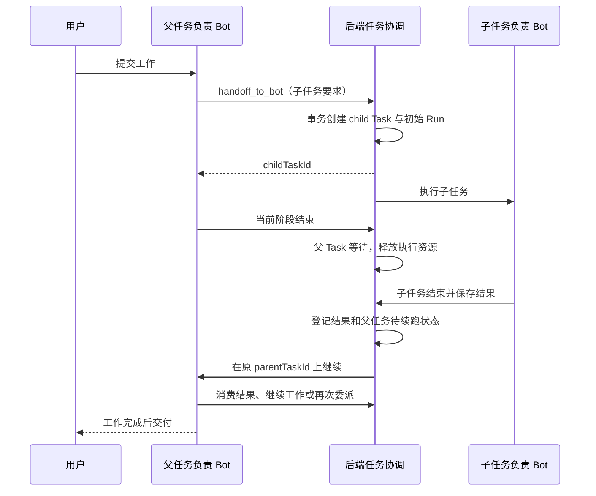
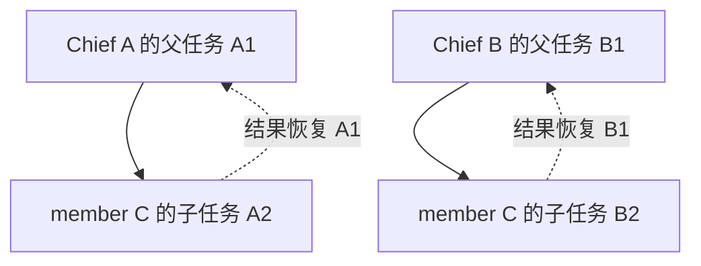

# 第一阶段方案：Bot 管理角色与持久化父子任务

状态：第一阶段已实现，已完成下述自动化验证与独立源码复核。第 1–15 节保留设计与源码对照记录，第 16 节记录实际实现、升级方式与验证范围。群协作不在本次实现范围内。

分析日期：2026-10-20。源码基线：

- Rakazo：`dd684d67481b3bc21429cd3b65a117555bcef431`。
- DS-Bot：`e13bc3419d2695a509520d850a07e63f05c34e07`。

文中的“当前”描述以上版本的源码；“本期”描述拟实现的行为。字段和新工具名称属于建议契约，实施时可沿用项目命名习惯，但不得改变下面的权限边界和任务语义。

## 1. 目标和范围

第一阶段让用户能够指定 Chief 管理普通 Bot，并让 Bot 之间的工作委派形成可追踪、可恢复、会自动交付结果的父子任务。

本期需求：

1. Bot 分为 `chief` 和 `member` 两个管理级别；后端执行不同权限。
2. 增强 `handoff_to_bot`，在私聊工作中创建子任务。发起者保留父任务和统筹责任，可以继续工作或等待结果。
3. 子任务完成、失败或取消后，系统可靠地通知原父任务；父任务在原 `taskId` 上继续。
4. 一次工作可以派出多个子任务，普通 Bot 也可以继续分解自己的任务。
5. 新任务协作不设置固定交互次数或固定委派跳数上限。
6. 权限、任务、上下文和结果关联遵守 `(spaceId, userId)` 边界。
7. 按前文建议，允许每个用户在一个 Space 内有 0 到多个 Chief，不要求唯一，不自动补建。
8. Chief 是否检查质量、要求返工，由用户要求和任务提示词决定；系统管理任务生命周期，不强制业务验收。

本期不包含群管理员、群主持、群消息路由、群讨论模式、群内投票或群共享上下文改造。现有群功能继续使用原有路径；本文中的新委派流程先在私聊任务中实现。

也不包含跨 Space 父子任务、跨用户团队授权、平台超级管理员、强制 `accept/reject` 流程、自动选举 Chief，以及一次停止某个 Bot 全部工作的全局 `stop_bot`。

## 2. 源码对照结论

| 能力 | DS-Bot 当前实现 | Rakazo 当前实现 | 本期处理 |
|---|---|---|---|
| Bot 管理级别 | `mainBotIds` / `isMain`，创建 Bot、修改其他 Bot、停止其他 Bot 有 Main 检查 | `fleetManagement` 开关；部分操作依赖 `parentBotId` 创建关系，没有 Chief 角色 | 新增明确管理角色，收敛 Bot 管理权限 |
| 普通 Bot 委派 | `message_bot` 对普通团队 Bot 开放，检查目标和上游等待关系 | 私聊 `message_bot` 可唤醒其他 Bot | 普通 Bot 保留任务协作权，不获得团队管理权 |
| 父子工作 | `state.works` 记录 `parent/open/results`，结果回到原工作 | `Task` 有多个 `Run`，没有父子关系 | 扩展现有 Task，不另造一套群任务系统 |
| 结果回传 | `closeWork` 登记结果，`takenWork` 表示上游已读取 | 已有自动回传、幂等和恢复机制；回传再次新建 Task | 复用可靠性基础，新增同一父 Task 的续跑语义 |
| 群 handoff | 与自身工作关系及群会话结合 | 当前 `handoff_to_bot` 只在群内，转交后停止本轮后续工具并抑制最终输出 | 新私聊委派独立接入；不复用旧群的结束标志 |
| 质量审核 | 所核对的交付路径没有强制 accept/reject 状态机 | 没有对应的持久化父子任务验收流程 | 不增加强制审核；返工是后续任务 |
| Chief 数量 | 团队至少一个 Main，允许多个，缺失时初始化一个 | 无 Chief；支持空 Space 和多用户成员 | 采用 0..N，并限定到用户在 Space 内的团队 |
| Space | 插件状态是一套团队和一个 `workspaceId`，工作目录可另设 | Space 有成员、数据隔离和独立生命周期 | 不把 DS 的工作目录当作 Rakazo Space 权限模型 |

重要修正：

- Rakazo 并非“完全没有结果回传”。缺失的是父子关系、父任务持续存在和恢复原任务的闭环。[R3]、[R4]
- DS 的 Main 权限检查来自运行时代码，不只是角色提示词。[D1]
- DS 的 `role` 字段是展示职能标签，不能直接映射为管理级别。[D1]
- DS 的完成回传没有强制 Chief 审核；不能把上下文整理器当成质量裁判。[D2]、[D3]
- DS 文档提及删除 Bot，但所核对的工具注册中没有 `delete_bot`；不能宣称其 Agent 工具已经完整暴露删除能力。
- DS 的 `update_bot` 检查调用者是否 Main，并未禁止 Main 修改另一 Main；本文“Chief 不管理其他 Chief”是本期采用的更严格规则，并非照抄 DS。[D1]

## 3. 三种关系必须分开

| 概念 | 建议表示 | 含义 |
|---|---|---|
| 管理权限 | `Bot.managementRole` | Chief 或普通 Bot，决定可执行的管理操作 |
| 创建来源 | 现有 `Bot.parentBotId` | 这个持久 Bot 由谁创建；保留历史来源，不再作为 Bot 管理授权依据 |
| 任务依赖 | 新增 `Task.parentTaskId` | 当前任务为哪个父任务执行，结果交付给谁 |

一个普通 Bot 可以有多个子任务。一个 Chief 不必亲自创建所有受管理的普通 Bot。某个 Bot 被两个 Chief 分派工作时，两个子任务分别属于各自的父任务。

Chief 是 Bot 管理角色，不是人类的 `SpaceMember.role`，也不等于平台管理员。持久 Bot 和执行器中的临时 subagent 仍是不同对象；不得因为所属 Bot 是 Chief，就给临时 helper 下发管理工具。

## 4. Chief 与普通 Bot 的权限

### 4.1 权限矩阵

下表所有 Bot 管理操作都限于同一 `spaceId` 和 `userId`，并继续经过任务授权、工具开关和现有审批规则。

| 能力 | 普通 Bot `member` | Chief `chief` |
|---|---|---|
| 接收用户任务、使用自身已获授权的工作工具 | 允许 | 允许 |
| 查看用于路由的队友名称、职能和必要状态 | 允许 | 允许 |
| 委派当前任务的子任务、等待和接收结果 | 允许 | 允许 |
| 向已有任务补充要求、提问、答复和报告进度 | 按任务参与关系允许 | 按任务参与关系允许 |
| 查询自己负责的任务树 | 允许 | 允许 |
| 取消自己委派的子任务或子树 | 允许；不影响目标 Bot 的无关任务 | 允许；同样按任务定位 |
| 查看本域普通 Bot 的管理资料和任务管理摘要 | 不额外授予 | 允许；只返回管理所需信息 |
| 创建持久 Bot | 不允许 | 允许；创建结果默认 `member` |
| 修改其他普通 Bot 的资料、指令、模型 | 不允许 | 允许；按操作执行审批和冲突检查 |
| 为其他普通 Bot 创建例行任务 | 不允许 | 允许；复用现有创建能力与审批 |
| 查看、修改、取消其他 Bot 已有的例行任务 | 不新增这类能力 | 本期不新增；自己的例行任务仍沿用现有工具 |
| 归档其他普通 Bot | 不允许 | 允许；沿用审批并处理在途任务 |
| 管理性取消本域普通 Bot 的指定任务 | 不允许，除非该任务属于自己的委派树 | 在当前任务授权范围内允许；使用明确的 `taskId` 和原因 |
| 修改自己的普通资料或指令 | 沿用现有自我修改限制 | 沿用同样限制 |
| 修改、归档其他 Chief，或管理性取消其无关任务 | 不允许 | 不允许；由用户操作 |
| 提升或降级自己及其他 Bot 的管理角色 | 不允许 | 不允许；仅用户可设置 |
| 永久删除 Bot、改变 Space 成员权限 | 不新增这类能力 | 不因 Chief 角色获得这类能力 |
| 获取其他 Bot 的秘密值或跨用户数据 | 不允许 | 不因 Chief 角色获得访问权 |

管理摘要不等于完整历史、全部附件或凭据。成员之间的目录也不应暴露只有管理操作需要的完整指令。

### 4.2 后端授权

管理角色存入 Bot，不能只写在提示词中。模型把自己称作 Chief、修改职能标签或传入 `role=chief`，都不能改变权限。

权限检查至少覆盖：

1. 工具列表生成，隐藏不可用的管理工具。
2. 工具执行，重新读取当前角色、目标和所属范围。
3. 服务层目标解析，防止通过另一个入口绕过限制。
4. 审批恢复，重新检查角色撤销、目标角色和资源版本。

管理性写入须在提交事务内检查调用者角色、目标角色与所属范围，并与用户修改角色的路径使用一致锁顺序或条件写入。只在执行前读取一次角色不够：调用者可能随后被降级，目标也可能随后被提升为 Chief。需要外部清理的归档、取消操作应先提交已授权的操作状态，再可靠执行清理；不能让过期的预读结果继续创建新的管理操作。[R15]

原有 `FLEET_TOOL_NAMES` 不包含 `spawn_bot` 和 `archive_bot`，`update_bot` 又同时支持自我修改和修改其他 Bot，因此只替换 fleet 工具的一个判断不够。[R2]、[R5]

现有 `create_child_routine` 只创建例行任务，`schedule_list/cancel` 的目标固定为调用者自己。本期不借角色改造扩展为完整的跨 Bot 例行任务管理。[R16]

临时 helper 不获得 Chief 管理权限。普通 Bot 接到 Chief 的子任务，也不继承 Chief 身份。

### 4.3 原始授权与结果续跑

当前 fleet 工具还受“用户直接发起”及运行期间外部消息来源限制。结果返回不能被伪装成用户新消息来绕过这些限制。[R6]

本期应持久化原任务的可信授权来源及需要跨 Run 保留的来源限制：

- 同一父 Task 的 continuation 恢复该父任务原有授权，同时按当前角色、工具权限和来源限制重新检查。
- 子 Task 是委派工作，不自动获得原用户直接发起管理操作的身份；记录根来源用于追踪，不等于授予管理能力。
- member 向 Chief 发消息或委派任务，不能借此取得 Chief 管理权限。
- 用户中途降级 Chief 后，其旧任务仍可接收结果和完成普通工作，但不能继续执行被撤销的管理操作。
- 新到达的外部来源限制跨 continuation 保留，不能随着已消费 steering 行被清理而丢失。
- 审批卡的“批准/拒绝”属于操作授权，与“Chief 是否审核交付质量”是两回事；本期不移除现有操作审批。

### 4.4 与现有 fleet 开关的兼容

`managementRole` 成为新 Bot 管理能力的唯一角色依据。`parentBotId` 不再授予管理权，旧 `fleetManagement=true` 也不能旁路 Chief 检查。

由于现有 fleet 集合混有群工具，本期应按操作拆分：

- Bot 管理分支改用 Chief 角色与新的本域目标解析。
- `create_group`、`update_group` 等旧群分支保留原开关、授权和审批；不因为 Bot 成为 Chief 就自动增加群权限。
- `list_fleet`、`organize_bot` 等混合入口按目标与返回内容分别授权；Bot 分支不能携带旧群能力，群分支也不能恢复旧 Bot 管理权限。
- 设置界面明确区分角色设置和保留的群相关旧能力，不能出现两个都声称控制 Bot 管理的开关。

这是迁移兼容处理，不新增群治理规则。

## 5. 父子任务流程

### 5.1 Task 与 Run

Task 表示一项尚未结束的工作；Run 表示一次执行。父任务等待子任务期间可以没有运行中的 Run。

当前 `finalizeRunOnce` 把 Run outcome 直接写入 Task，普通 steering continuation 也会新建 Task。这两处必须调整，不能直接用于持久化父任务恢复。[R7]

建议 Task 的逻辑状态：

| 状态 | 含义 |
|---|---|
| `queued` | 工作已登记，等待执行 |
| `running` | 正在执行当前阶段 |
| `waiting_children` | 当前阶段结束，仍有未结束的子任务或待处理结果 |
| `completed` | 该任务已完成，结果已持久化 |
| `failed` | 不再由系统重试的任务失败 |
| `cancelled` | 任务已被取消 |

已有 `waiting_input`、`waiting_takeover` 表示等待输入或接管，不能被视为任务终态。具体是否映射到 Task 状态可沿用项目约定，但必须保留可继续性。某次 Attempt/Run 失败后仍有系统重试时，也不能先把 Task 当作永久失败回传。

### 5.2 标准流程

具体规则：

1. 用户任务创建父 Task，负责 Bot 保持不变。
2. `handoff_to_bot` 创建新 Task，记录父关系和委派来源；不修改父任务 `botId`。
3. 同一 Run 可以多次委派不同子任务，然后继续独立工作。
4. 当前 Run 可结束并释放执行、计算机等租约；等待中的父 Task 不得占住子任务需要的资源。
5. 子任务可以继续派生孙任务；禁止委派给自己，也不能通过新任务把工作交回正在等待自己的祖先 Bot。
6. 子任务进入终态后，后端自动登记结果，并通知原父 Task。
7. 父 Bot 空闲时调度 continuation；正在执行时先持久化待处理事件，不并发启动第二个同一父任务执行。
8. 父 Bot 正在处理另一项任务时，结果按原 Task 排队，不能塞进无关任务作为新的工作指令。
9. 部分子任务先完成时，父任务可以先消费、继续工作；不要求等全部完成才第一次唤醒。
10. 父任务可以在结果回来后再创建新子任务，任务树继续归属于同一根任务。

成功完成父任务必须同时满足：

- 本轮有可确认的正常结束，且父 Bot 已决定完成工作；
- 没有仍需等待的非终态子任务；
- 没有尚未可靠消费的子任务结果或需要处理的任务事件；
- 没有待恢复的输入、接管、审批或系统重试。

“全部子任务完成”不自动等于“父任务完成”。父 Bot 仍需按用户要求汇总或继续工作；对子任务没有质量审核要求时，不额外增加审核关卡。

### 5.3 建议工具语义

| 工具或能力 | 本期语义 |
|---|---|
| `handoff_to_bot` | 创建子任务，返回 `childTaskId`、初始状态和目标信息；保留父任务 |
| 关联任务的 `message_bot` | 补充要求、进度、问题和答复；不据此新建独立 Task 或宣告任务完成 |
| 任务状态查询 | 返回授权范围内的状态、子任务和结果摘要；具体复用或新增工具名在实施时确定 |
| 任务取消 | 按 `taskId` 取消指定任务及其依赖子树；不按 Bot 粗暴停止全部工作 |
| `spawn_bot` 无初始工作 | Chief 创建持久 member，不自动形成一次任务委派 |
| `spawn_bot` 带初始工作 | 创建 Bot 后，初始工作进入同一父子任务服务，返回 Bot 与子任务标识 |

关联任务的消息必须校验当前 Run、参与关系和目标。工具参数中的 `taskId` 只是定位请求，不能凭它获得任意任务访问权；父任务及授权来源由后端确定。

任务内问题持久化问题标识、提问方、答复方、答复状态和待处理事件。向上游提问可以唤醒上游处理，但不创建反向子任务依赖；下游结束 Run 等待答复时释放资源，Task 仍保持非终态，不能因本轮正常结束就宣告成功。该结构化问答通道是本期设计，不宣称 DS 已有相同实现。

工作请求统一走委派流程。旧的无任务关联 `message_bot` 保留兼容行为，但不作为新任务闭环中的派工入口。显式 `intent=result` 只是消息内容，不能清除父任务依赖或替代后端终态事件。

### 5.4 交付、返工和重新分派

交付包含可定位的结果正文、产物引用、终态和必要错误信息。不能只留下“已完成”而丢掉产物位置；长结果保存完整内容或可读取引用，提示词可按需使用摘要。

交付产物必须建立父任务可持有的保留关系。当前删除 Bot 会主动删除该 Bot 的 Artifact 记录及对象存储文件，仅复制原 `artifactId` 或 URL 仍会失效。应在交付时建立共享保留归属，或在删除前迁移父任务仍需要的产物及文件保留责任；不能只保存结果文本而让已交付文件被清理。保留范围仍受原 Space/用户授权约束，Space 整体删除时按其生命周期清理。[R18]

本期不新增 `submitted/accepted/rejected/needs_revision` 状态。若用户要求 Chief 检查质量，Chief 读取结果后决定继续或要求补充；返工创建新的关联子任务，说明原结果和修改要求。已完成 Task 不反复重开，保留可追溯历史。

重新分派也不直接改写已运行 Task 的负责人：取消或结束原子任务，再创建替代子任务并记录关联。旧结果迟到时不能覆盖新任务结果或自动宣布根任务成功。

## 6. 上下文和结果归属

子任务的输入应包括：工作目标、必要背景、交付要求、可访问的材料引用，以及原任务明确给出的约束。不要默认复制 Chief 的整段私聊、全部历史、秘密值或管理授权。

父任务 continuation 应能恢复：原始请求、已保存的阶段进展、子任务状态、未消费的结果和待答复问题。不能只让模型看到一条脱离原任务的“某 Bot 回复了”。

原始请求和阶段执行提示必须分开。当前问答恢复会覆写 `Task.prompt`；新协议不能把这个可变字段作为原始目标和约束的唯一来源。保存不可变的原始请求引用或快照；若原消息生命周期不能保证可重建，则保存快照。回答问题或恢复审批后仍能还原最初请求、任务约束和可信来源。[R19]

同一 Bot 可以执行来自多个 Chief 的任务。运行时以 `taskId` 选择当前工作及关联事件，不能仅按 Bot 的“最新一条消息”路由结果。Bot 自己的长期人格、记忆和授权可读历史仍可沿用现有能力；任务隔离至少保证当前指令、待处理结果、授权来源和最终交付对象不串线，不在本期承诺新的物理沙箱隔离。

Task 是完成状态的事实来源；聊天消息负责呈现和提供上下文。Chief 说“完成了”不能越过未结束子任务；普通 Bot 发一条 `result` 也不能伪造终态。

## 7. 数据与可靠性设计

### 7.1 最小持久化信息

优先扩展现有 Task/Run 及事件机制，字段布局可调整，但必须保存下列信息：

| 对象 | 需要保存的信息 |
|---|---|
| Bot | `managementRole`，默认 `member` |
| Task | `parentTaskId`、根任务引用、委派来源 Run、稳定委派键、生命周期时间与终态 |
| Task 来源 | 不可变原始请求引用或快照、外部来源引用、可信授权来源、跨 Run 保留的来源限制；与可变阶段提示分开 |
| Task 结果 | 终态结果、错误、产物引用以及产生该结果的执行标识 |
| 父任务待处理记录 | 子结果或任务消息、投递关联、消费关联、待续跑信息 |
| 协议标识 | 能明确区分旧消息任务与新持久化任务流程，包含没有父节点的根 Task |

不要另建一套与 Task 竞争的“完成状态”。父任务查询、回传、取消和 UI 使用同一套事实。

`parentTaskId` 一经建立不被模型随意改写。建立关系时校验父子 `spaceId/userId` 相等；数据库约束和事务内校验共同保证。根引用从父记录推导，不相信模型传入值。按父任务、状态和未处理事件建立必要索引。

### 7.2 幂等、并发与消费

1. **创建幂等**：使用调用级稳定键，区分同一 Run 内不同委派。当前 `effectKey` 已考虑相同参数的多次调用，可作为基础；旧群 `group-handoff:${run.id}` 不能用于多子任务。[R8]
2. **终态幂等**：子 Task 终态不可重开时，以子 Task 标识去重结果回传；不能仅凭消息 intent 或最后一个 Run 判定。
3. **事务边界**：子任务终态、结果登记和父任务待续跑事实在同一事务中提交。队列投递在提交后进行；未成功 enqueue 可由恢复任务补投。
4. **并发归并**：两个子任务同时结束时，使用一致锁顺序协调父 Task 和执行线程，不各自创建冲突的 continuation。
5. **消费可恢复**：“结果已经到达”“已装入某次 Run 上下文”“父任务已经可靠消费”必须区分。结果正文持续可读；不能仅在模型调用开始时就永久清除待处理状态。
6. **执行失败**：消费确认应与可恢复的执行结果或检查点关联；崩溃重试可重新装载尚未确认消费的结果。
7. **最后结果竞争**：检查父任务能否完成，与检查新结果/新子任务必须处于一致的事务判定范围。
8. **队列恢复**：无运行中的 Run、但有未消费事件或待执行子任务时，reconciler 能重新推进。

沿用现有数据库事务、租约 fencing、消息 nonce、提交后 enqueue 和 reconciler 能力，不要求引入新的队列供应商。[R3]、[R4]

新协议任务只能有一条结果完成路径。执行器和 reconciler 应识别新协议，避免旧 `returnBotMessageOutcome` 再创建一份回复 Task。旧 `botOutcomeReturnedAt` 继续服务历史消息任务，不能成为新父任务完成依据。

### 7.3 取消、失败、归档与删除

- 子任务失败或取消时，仍存活的父任务收到明确终态，可以告知用户、重新分派或继续完成其他工作。
- 父任务取消后，取消其未结束的依赖子树；不得取消目标 Bot 的其他独立任务。
- 父任务失败且不再恢复时，也必须结束或取消其未结束依赖，避免无人负责的后台工作。
- 被取消的父任务不因迟到消息、迟到结果或队列重放而复活。
- 任务处于等待输入、接管、审批时，也必须能被取消；清理时处理相关暂停状态。
- Chief 降级只撤销管理能力，不自动改写任务树或抹去交付关系。
- Bot 归档或删除前，停止该 Bot 的相关执行并将它承担的未结束任务明确终结，通知其他仍存活的父任务；它负责的依赖子树也需处置。
- 归档、删除与任务级取消按非终态 Task 定位工作，再处理它们的 Run 和子树；不能只从 active Run 反查。当前 `archiveBot` 按活动 Run 更新 Task，新 `waiting_children` 可能没有活动 Run，照搬会漏掉这些工作。[R17]
- 硬删除可能级联删除 Task。必须先把其他父任务需要的结果/取消记录存到不会随目标 Bot 被级联删除的位置，不能留下永久等待。
- 删除 Space 沿用先清空内容的既有生命周期。清理不应因“必须保留最后一个 Chief”而被阻止。

当前 `cancelRunsInTransaction` 会直接取消 Run 对应 Task；已有 outcome reconciler 对 cancelled 的覆盖也仅包含特定卡住任务。这些不是完整的新任务取消传播机制，必须补齐。[R4]、[R9]

### 7.4 完成通知与外部交付

当前不仅 Task 状态跟随 Run 结束，执行器完成通知、外部聊天交付、Bot 回复镜像和恢复补投也有按 Run 终态处理的入口。只修改 `finalizeRunOnce` 或来源回溯不足以解决提前交付。[R20]、[R21]、[R22]

新协议要求：

- 阶段 Run 正常结束而 Task 仍等待子任务时，输出只能作为阶段进度；不发最终完成通知，不把外部请求标记为已经交付完毕。
- Task 进入最终终态后才形成最终交付记录，使用任务、交付目的地及交付类型组成的稳定键，恢复扫描与实时发送共用它。
- 子任务交付首先面向父 Task；根任务最终结果回到原请求目的地，不能把每个子结果都当成根任务最终答案。
- 对旧协议保持原有 Run 语义；新协议从旧 Run 完成/镜像扫描中分流，避免重复回传或提前结单。
- 前端任务状态与通知消费同一生命周期事实，不能仅收到 `run.completed` 就把等待中的任务显示为完成。

这里调整的是新协议任务的交付时机和去重，不改变群回复模式或群治理。

## 8. 取消交互次数限制

当前 `BOT_MESSAGE_MAX_HOPS` 默认 6；它按消息来源递增，限制链深度，不限制总扇出。自动终态回传原请求方已有例外；设置 0 不会关闭限制。[R10]、[R3]

本期取消的范围：

- 新协议中的子任务委派与嵌套委派；
- 关联任务的补充要求、问题、答复和进度；
- 子任务终态回传、父任务恢复以及恢复后的进一步委派。

这些路径不能直接或间接再受旧 hop 判断限制，也不增加等价的固定深度、固定往返次数替代规则。

本期保留旧规则的范围：

- 无任务关联的自由 Bot 消息链；
- 尚未迁移的群 `handoff_to_bot`；
- 跨 Space 的 `message_agent`；
- 外部群的旧消息自动唤醒路径。

因此不能全局删除共享 helper 或将其改为恒不超限。消息长度、模型上下文长度、工具参数上限与交互次数不是同一限制，继续按各自现有规则处理。

新任务防止失控依靠：稳定的任务关系、拒绝向等待自己的上游重新委派、重复投递幂等、纯确认消息不制造自动往返、已有运行保护与用户取消。任务树无环不等于模型必然有限运行；如果用户配置了时间或资源预算，应按根任务记录和执行，不因子任务重置。此处不要求新增固定次数预算。

外部聊天的 `findExternalOrigin` 当前也使用相同 hop 数回溯来源。新协议需要直接利用可信的根任务来源，不能出现任务能执行到更深层，但结果投递在第 6 跳丢失来源的问题。仅调整来源关联，不改变群回复策略。[R11]

## 9. Space 隔离与多个 Chief

### 9.1 权限范围

Chief 管理的是当前用户在当前 Space 内的普通 Bot。不能删除查询中的 `userId` 条件，也不能因用户有多个 Space 就合并管理范围。

现有 `SpaceMember.role` 是人类成员权限；Chief 不能修改它。所有新任务查找、消息关联、产物读取、回调恢复和管理性取消都重新验证范围。[R12]

同一 Bot 当前有一个 `spaceId`。本期不增加跨 Space 移动、跨 Space 角色继承或跨 Space 父子任务。切换界面中的 Space 不取消原任务，不改变后端绑定的 Space。

现有 AgentConnection 是经批准的跨 Space 通信。批准通信不等于批准管理权限，也不等于可以把对方任务挂到本地父任务树下。[R13]

### 9.2 Chief 数量：0..N

本期不增加“至少一个 Chief”约束，不增加整个 Space 或用户团队的 Chief 唯一索引。

- 空 Space 合法；只有普通 Bot 的 Space 也合法。
- 用户可设置一个或多个 Chief，也可降级最后一个 Chief。
- 首个 Bot、没有 `parentBotId` 的 Bot、复制出来的 Bot、Chief 创建的 Bot，都不因此自动成为 Chief。
- 没有 Chief 时，普通 Bot 仍可工作和进行任务委派；用户通过设置管理 Bot。
- 不自动创建一个“补位 Chief”，也不额外引入 Primary Chief 权限等级或默认 Chief 路由字段。

DS 的 1..N 是其团队入口和初始化规则。Rakazo 目前创建空 Space，删除 Space 又要求所有 Bot（包括归档 Bot）和群已清空；直接复制 DS 的最后 Main 不可降级规则会阻断清空流程。[D4]、[R14]

如果将来产品明确要求“启用某种团队模式时至少一个 Chief”，需要另行设计角色替换、清空和删除例外；本期不附带加入这种模式。

### 9.3 多 Chief 的协作

Chief A 和 Chief B 可以同时给 member C 分配不同任务：

每个 Task 的负责人唯一；结果沿 `parentTaskId` 找到原负责 Bot，不能查“Space 当前 Chief”决定接收方。多个 Chief 不自动互相接管、重复汇总或收到对方所有结果。

同一 member 的实际执行沿用线程/执行资源调度，不能为支持多 Chief 绕开现有串行与租约保护。不同任务在该 Bot 的线程中可排队，但上下文与回调按 Task 关联。

多个 Chief 修改同一个 member 的配置时，指令和模型复用已有的冲突检查。资料与置顶/分区等配置目前没有通用版本保护，本期应补充预期版本或等价的条件写入：冲突时明确失败并重新读取，不静默覆盖其他 Chief 或用户刚提交的修改。尤其审批期间发生变化时，旧审批不得覆盖新状态。这部分是新增改造，不能泛称为沿用现有能力。[R15]

Chief 对其他 Chief 的管理性修改仍由用户完成；普通任务协作不因此被禁止。

## 10. 迁移与兼容

1. **先加数据结构**：新增角色默认 `member`，新任务字段允许历史数据没有父关系。现有记录不臆造任务树。
2. **不自动扩大权限**：不从 `fleetManagement=true`、`parentBotId=null` 或创建顺序推断 Chief。用户通过角色设置显式选择。
3. **明确迁移影响**：旧 fleet 用户需要指定 Chief 才能继续使用本期收敛后的 Bot 管理能力；普通 Bot 原可用的持久 Bot 创建等入口会按新矩阵收紧。保留的群能力按原规则运行。
4. **历史任务走旧路径**：旧群交接和旧消息任务继续由原完成机制收尾；不得把运行中的旧请求强行改挂到推断出的父任务。
5. **新任务只走新路径**：协议识别覆盖根 Task、委派子 Task 和 continuation，避免新旧回传重复执行。
6. **防止旧客户端绕行**：旧客户端不传角色时保留后端值；修改旧 fleet 字段不得提升 Bot 管理权限。
7. **统一服务入口**：私聊 handoff 与 `spawn_bot(prompt)` 使用同一个委派服务；Bot 创建成功而初始任务未完成登记时，重放应能补齐，不再创建第二个 Bot。
8. **发布与回退**：先部署能读新字段和处理新协议的执行器，再开放新入口；不能让旧 worker 领取无法处理的新协议任务。回退应关闭新建入口并保留兼容 worker 收尾，不能把等待中的父任务降格为“某次 Run 已结束”。

工具可见性和执行检查还必须按协议过滤，不能只看是否私聊。上线时明确新协议根任务的创建入口：适用的私聊用户请求、直接通话结束及获支持的独立私聊任务触发器，在创建 Task 时写入协议标识；子任务与 continuation 沿用同一协议。群、自由 Bot 消息和跨 Space 消息的旧路径继续标记为旧协议。

旧协议 Task 不得直接创建新协议子任务，也不得获得“关联任务消息免 hop”的入口；它仍按旧规则结束。若旧路径仍开放带初始工作的 `spawn_bot`，只能维持旧协议语义，不能把新协议子项挂在旧 Task 下。需要新协作时从明确支持的新根任务入口开始，不在运行中根据提示词、消息来源或有没有 Chief 推断升级。

## 11. 改造步骤与代码落点

按以下顺序实施，可拆分提交，但完整验收前不能声称父子任务闭环已完成。

| 步骤 | 工作内容 | 主要落点 |
|---|---|---|
| 1 | 角色、任务关系、协议识别、结果与待处理事件契约 | `packages/contracts`、Prisma schema 与 migrations |
| 2 | 统一 Bot 管理权限；事务内授权与配置冲突检查；拆分 Bot 与群分支；用户角色设置 | `executor.ts`、`fleet-tools.ts`、`child-bots.ts`、`bot-update.ts`、`action-approval.ts`、API 与 repos |
| 3 | 创建子任务、调用级幂等、范围和循环校验 | 新任务协调服务，复用 DB/队列边界 |
| 4 | 新根任务创建与协议过滤；私聊 handoff；整合 `spawn_bot(prompt)` | Task 创建入口、`schedule-tools.ts`、`executor.ts`、`child-bots.ts` |
| 5 | 拆分 Task 与 Run 完成；原始请求保存；原 Task continuation；结果消费 | `events.ts`、执行器上下文构建、任务协调服务 |
| 6 | 任务消息/问答、取消跳数、最终通知和回传按协议分流 | `bot-messages.ts`、core 消息契约、执行器、`messaging-delivery.ts`、`team-chat-bridge.ts` |
| 7 | 从 Task 取消/归档；交付产物保留；恢复补投与并发处理 | `cancel-runs.ts`、`job-reconciler.ts`、Bot/Artifact/Space 生命周期 |
| 8 | 最小角色设置、任务状态与交付关联展示 | 共享契约；Web/Electron 共用界面；移动端原生设置 |
| 9 | 数据迁移、兼容验证、测试与文档更新 | 离线测试、Postgres 集成测试、现有 fleet 文档 |

实现提示：

- 不复用私聊流程中的 `handedOff=true`：现有标志会禁止后续工具调用并丢弃最终输出，不支持同轮多次委派。[R8]
- 当前 `createdByWhere` 和部分 `resolveBot` 限制创建者；Bot 管理分支要改为本域 member 授权，不能只放宽查询而遗漏调用者权限。[R5]
- 不用现有 steering continuation 直接替代父任务续跑，因为它创建新 Task。[R7]
- 不用模型发出的 `intent=result` 决定终态，因为旧自动回传会据此跳过重复结果；新任务完成必须由后端事实决定。[R3]
- 后端统一编排、授权、恢复与提供商边界；前端表达用户意图并显示状态，不自行推断父任务完成。
- 不增加新托管服务依赖，不复制已有 provider 适配逻辑。

## 12. 用户界面与提示词

界面仅提供必要能力：

- Bot 设置中可由用户选择 Chief 或普通 Bot；Web、Electron、移动端使用同一角色契约。
- 任务展示能看出委派给谁、等待中或已结束，以及结果关联。先复用现有消息/工具活动呈现，不以完整任务树控制台作为本期前提。
- 等待子任务时不能显示根任务“已完成”；需要用户输入或任务失败时显示现有对应状态。
- 取消操作明确作用于具体任务，不让“停止任务”隐含停止该 Bot 的全部工作。
- 旧群能力的入口与文案保留准确语义，角色设置不误导用户认为群管理员功能已经上线。

Chief 提示词说明管理范围、派发、跟踪和汇总职责；member 提示词说明执行、按需继续委派、报告困难与自动交付。两者都说明：进度不等于完成，结果会自动回到父任务，不向等待自己的上游再次派工。

提示词不强制 Chief 每次验收；不把角色提示词当成后端权限。所有新增可见文案在实际 UI 改造时按项目要求保持最小，并在 PR 中记录必要性。

## 13. 设计验收清单（原始）

权限与边界：

- [ ] member 无法创建持久 Bot、修改/归档其他 Bot，绕过工具可见性直接调用也失败。
- [ ] Chief 可管理同域 member，包括并非自己创建的 Bot；不能修改其他 Chief 或跨 Space/用户管理。
- [ ] 用户可以配置 0、1、多个 Chief；新建和复制 Bot 默认 member。
- [ ] 审批等待期间角色撤销、目标升为 Chief 或配置版本变化时，旧审批不能继续越权执行。
- [ ] 角色检查与写入之间发生调用者降级或目标升级时，事务不会提交已失效的管理操作。
- [ ] 多 Chief/用户并发修改资料、分区或置顶时，条件写入明确报告冲突；指令、模型原有保护继续生效。
- [ ] member→Chief 委派、外部消息和临时 helper 不获得 Chief 的用户发起管理授权。
- [ ] 父任务 continuation 保留原任务授权与外部来源限制；用户降级后权限即时收紧。
- [ ] 旧 fleet 群功能保持原行为，不能作为新 Bot 管理权限的旁路。

任务闭环：

- [ ] 同一 Run 可创建两个子任务且不转移父任务归属。
- [ ] 支持嵌套委派，最终结果逐级恢复原 Task；超过 6 跳的合法新任务链仍能完成。
- [ ] 超过 6 次的任务内问答、进度和继续委派不被旧消息 hop 截断。
- [ ] 禁止向自己或正在等待自己的祖先 Bot 再委派；上游问题有持久化答复状态，待答复期间 Task 不会提前完成。
- [ ] 子任务未结束、结果未消费或问题未处理时，父任务不能成功完成。
- [ ] 部分结果先到可唤醒父任务；两个结果并发到达不会重复执行父任务或漏掉最后结果。
- [ ] 父 Bot 正在处理其他任务时，结果排队归回正确 Task，不混入当前工作。
- [ ] 子任务显式发送 `result` 后继续执行或失败，不会造成提前完成或漏掉真实终态。
- [ ] 同一调用崩溃重放不重复创建子任务；同一 Run 两次有意委派不会被错误合并。
- [ ] 提交后 enqueue 失败、结果消费前后崩溃、服务重启，均可恢复且不重复交付。
- [ ] 问答和审批恢复后，原始请求、约束和可信来源仍可重建，不受 `Task.prompt` 改写影响。
- [ ] `spawn_bot(prompt)` 的 Bot 创建和初始子任务登记可幂等补齐。
- [ ] 父任务等待时释放资源，同计算机上的子任务仍可运行。
- [ ] 子任务失败/普通取消能回传；父取消后迟到结果不复活父任务，目标 Bot 无关任务继续。
- [ ] Bot 归档/删除不会使其他父任务永久等待；Space 仍能按既有条件清空和删除。
- [ ] 父任务处于无活动 Run 的等待状态时，归档/删除仍能找到并终结它；已交付产物在子 Bot 删除后仍可被父任务读取。
- [ ] 多 Chief 共用 member 时，各自的任务输入、结果、取消和交付对象不串线。
- [ ] 新协议外部结果使用正确原始来源，不受旧 6 跳回溯截断；旧协议不重复回传。
- [ ] 阶段 Run 结束时不发最终完成通知、不提前关闭外部请求；内部 Task 终态结果幂等登记；外部发送使用稳定键恢复，交付保证见第 16 节。
- [ ] 旧协议任务无法调用新委派入口或创建新协议子项；支持的新根任务从创建时即携带正确协议标识。

测试以确定性离线单元测试和数据库集成测试为主，覆盖授权、事务竞争、恢复和取消。实际 UI 实现再做适用的 Web/移动端验证；不把本机真实 Electron E2E 作为常规检查。本节是设计阶段的验收范围；实施后的验证结果见第 16 节。

## 14. 源码证据

以下为分析时固定版本的链接，便于后续复核，避免用仓库宣传描述替代代码行为。

### Rakazo

- [R1：Bot、Task、Run 数据模型][R1]：角色缺失、创建关系与现有 Task/Run 结构。
- [R2：fleet 工具集合][R2]：并非所有 Bot 管理入口都在同一工具列表。
- [R3：Bot 消息与自动结果回传][R3]：目标范围、旧 hop 例外、独立 Task、回传去重。
- [R4：结果恢复扫描][R4]：终态回传与 cancelled 覆盖范围。
- [R5：Bot 创建与创建者目标限制][R5]、[fleet 目标解析][R5b]：`parentBotId` 的实际作用。
- [R6：用户发起判定][R6]、[执行期管理权限复查][R6b]：角色之外的原始授权要求。
- [R7：Run 与 Task 结束耦合及 steering continuation][R7]。
- [R8：旧群 handoff][R8]、[线程工具过滤][R8b]、[执行器 handoff 分支][R8c]、[调用级 effectKey][R8d]。
- [R9：Run 取消与 Task 更新][R9]。
- [R10：默认 6 跳限制][R10]。
- [R11：外部来源按 hop 回溯][R11]。
- [R12：Space 与成员模型][R12]、[双重范围校验][R12b]。
- [R13：跨 Space AgentConnection][R13]。
- [R14：创建空 Space][R14]、[Space 删除条件][R14b]。
- [R15：Bot 配置实际写入条件][R15]：现有版本检查不能泛化为所有资料与组织操作均受保护。
- [R16：例行任务工具的调用者范围][R16]：现有跨 Bot 能力仅创建。
- [R17：归档只从活动 Run 找任务][R17]。
- [R18：删除 Bot 时清理产物记录][R18]、[清理存储文件][R18b]。
- [R19：问答恢复覆写 Task prompt][R19]。
- [R20：执行器完成通知][R20]、[R21：外部完成扫描][R21]、[R22：消息镜像][R22]。

### DS-Bot

- [D1：message_bot 与 Main 管理工具][D1]：普通 Bot 可委派、上游检查、Main 创建/修改/停止权限。
- [D2：父子 work、结果登记和消费][D2]。
- [D3：结果回传][D3]、[等待子任务及结束判断][D3b]：无强制质量验收状态。
- [D4：Main 数量与删除规则][D4]、[bootstrap][D4b]。
- [D5：单团队状态与 workspaceId][D5]、[团队工作目录][D5b]。

[R1]: https://github.com/zhoumo99567/rakazo/blob/dd684d67481b3bc21429cd3b65a117555bcef431/packages/db/prisma/schema.prisma#L394
[R2]: https://github.com/zhoumo99567/rakazo/blob/dd684d67481b3bc21429cd3b65a117555bcef431/packages/contracts/src/builtin-tools.ts#L4
[R3]: https://github.com/zhoumo99567/rakazo/blob/dd684d67481b3bc21429cd3b65a117555bcef431/packages/adapters/src/bot-messages.ts#L65
[R4]: https://github.com/zhoumo99567/rakazo/blob/dd684d67481b3bc21429cd3b65a117555bcef431/packages/adapters/src/job-reconciler.ts#L264
[R5]: https://github.com/zhoumo99567/rakazo/blob/dd684d67481b3bc21429cd3b65a117555bcef431/packages/adapters/src/child-bots.ts#L51
[R5b]: https://github.com/zhoumo99567/rakazo/blob/dd684d67481b3bc21429cd3b65a117555bcef431/packages/adapters/src/fleet-tools.ts#L1142
[R6]: https://github.com/zhoumo99567/rakazo/blob/dd684d67481b3bc21429cd3b65a117555bcef431/packages/core/src/action-approval.ts#L148
[R6b]: https://github.com/zhoumo99567/rakazo/blob/dd684d67481b3bc21429cd3b65a117555bcef431/packages/adapters/src/executor.ts#L4635
[R7]: https://github.com/zhoumo99567/rakazo/blob/dd684d67481b3bc21429cd3b65a117555bcef431/packages/db/src/events.ts#L1327
[R8]: https://github.com/zhoumo99567/rakazo/blob/dd684d67481b3bc21429cd3b65a117555bcef431/packages/adapters/src/group-handoff.ts#L15
[R8b]: https://github.com/zhoumo99567/rakazo/blob/dd684d67481b3bc21429cd3b65a117555bcef431/packages/adapters/src/schedule-tools.ts#L27
[R8c]: https://github.com/zhoumo99567/rakazo/blob/dd684d67481b3bc21429cd3b65a117555bcef431/packages/adapters/src/executor.ts#L6940
[R8d]: https://github.com/zhoumo99567/rakazo/blob/dd684d67481b3bc21429cd3b65a117555bcef431/packages/adapters/src/executor.ts#L4787
[R9]: https://github.com/zhoumo99567/rakazo/blob/dd684d67481b3bc21429cd3b65a117555bcef431/packages/db/src/cancel-runs.ts#L4
[R10]: https://github.com/zhoumo99567/rakazo/blob/dd684d67481b3bc21429cd3b65a117555bcef431/packages/core/src/bot-messages.ts#L10
[R11]: https://github.com/zhoumo99567/rakazo/blob/dd684d67481b3bc21429cd3b65a117555bcef431/apps/api/src/team-chat-bridge.ts#L994
[R12]: https://github.com/zhoumo99567/rakazo/blob/dd684d67481b3bc21429cd3b65a117555bcef431/packages/db/prisma/schema.prisma#L199
[R12b]: https://github.com/zhoumo99567/rakazo/blob/dd684d67481b3bc21429cd3b65a117555bcef431/packages/db/src/scope.ts#L45
[R13]: https://github.com/zhoumo99567/rakazo/blob/dd684d67481b3bc21429cd3b65a117555bcef431/packages/adapters/src/agent-connections.ts#L35
[R14]: https://github.com/zhoumo99567/rakazo/blob/dd684d67481b3bc21429cd3b65a117555bcef431/apps/api/src/router.ts#L889
[R14b]: https://github.com/zhoumo99567/rakazo/blob/dd684d67481b3bc21429cd3b65a117555bcef431/packages/db/src/spaces.ts#L335
[R15]: https://github.com/zhoumo99567/rakazo/blob/dd684d67481b3bc21429cd3b65a117555bcef431/packages/db/src/bot-update.ts#L58
[R16]: https://github.com/zhoumo99567/rakazo/blob/dd684d67481b3bc21429cd3b65a117555bcef431/packages/adapters/src/executor.ts#L6011
[R17]: https://github.com/zhoumo99567/rakazo/blob/dd684d67481b3bc21429cd3b65a117555bcef431/packages/adapters/src/child-bots.ts#L294
[R18]: https://github.com/zhoumo99567/rakazo/blob/dd684d67481b3bc21429cd3b65a117555bcef431/packages/adapters/src/child-bots.ts#L401
[R18b]: https://github.com/zhoumo99567/rakazo/blob/dd684d67481b3bc21429cd3b65a117555bcef431/packages/adapters/src/child-bots.ts#L486
[R19]: https://github.com/zhoumo99567/rakazo/blob/dd684d67481b3bc21429cd3b65a117555bcef431/packages/db/src/events.ts#L856
[R20]: https://github.com/zhoumo99567/rakazo/blob/dd684d67481b3bc21429cd3b65a117555bcef431/packages/adapters/src/executor.ts#L7928
[R21]: https://github.com/zhoumo99567/rakazo/blob/dd684d67481b3bc21429cd3b65a117555bcef431/apps/api/src/team-chat-bridge.ts#L931
[R22]: https://github.com/zhoumo99567/rakazo/blob/dd684d67481b3bc21429cd3b65a117555bcef431/packages/adapters/src/messaging-delivery.ts#L70
[D1]: https://github.com/Fei2411/DeepSeek-Bot/blob/e13bc3419d2695a509520d850a07e63f05c34e07/ds-bot/src/host/tools.js#L148
[D2]: https://github.com/Fei2411/DeepSeek-Bot/blob/e13bc3419d2695a509520d850a07e63f05c34e07/ds-bot/src/host/handoffs.js#L29
[D3]: https://github.com/Fei2411/DeepSeek-Bot/blob/e13bc3419d2695a509520d850a07e63f05c34e07/ds-bot/src/host/turns.js#L187
[D3b]: https://github.com/Fei2411/DeepSeek-Bot/blob/e13bc3419d2695a509520d850a07e63f05c34e07/ds-bot/src/host/turns.js#L569
[D4]: https://github.com/Fei2411/DeepSeek-Bot/blob/e13bc3419d2695a509520d850a07e63f05c34e07/ds-bot/src/host/roster.js#L482
[D4b]: https://github.com/Fei2411/DeepSeek-Bot/blob/e13bc3419d2695a509520d850a07e63f05c34e07/ds-bot/src/host/roster.js#L564
[D5]: https://github.com/Fei2411/DeepSeek-Bot/blob/e13bc3419d2695a509520d850a07e63f05c34e07/ds-bot/src/host/store.js#L14
[D5b]: https://github.com/Fei2411/DeepSeek-Bot/blob/e13bc3419d2695a509520d850a07e63f05c34e07/ds-bot/src/host/roster.js#L21

## 15. 独立审核记录

审核日期：2026-10-20。两位 subagent 分别只读审核权限与 Space、任务生命周期与可靠性，并在文档修订后再次核对。两轮均使用本文开头记录的源码版本。

| 审核方向 | 初审发现并已修订的事项 | 复核结果 |
|---|---|---|
| 权限与 Space | 资料/置顶等操作缺少通用版本保护，应明确为新增；角色检查必须与提交原子关联；现有跨 Bot 例行任务能力仅创建 | 3 项均闭合；该范围未发现残余阻塞 |
| 任务与可靠性 | 完成通知和外部交付不能只看 Run；产物本体必须保留；无活动 Run 的 Task 也需被取消/归档；原始请求不能只依赖可变 prompt；新旧协议入口必须分流 | 5 项均闭合；该范围未发现残余阻塞 |

审核还补充确认：禁止向自己委派、上游问答必须持久化状态、Chief 不管理其他 Chief 是本方案比 DS 更严格的选择。

最终确认的设计结论：

- DS 具有 Main 管理权限和父子 work 闭环，但没有本方案所排除的强制质量验收状态机。
- Rakazo 已有可复用的消息回传和可靠性基础，仍需补齐角色、父子 Task、同 Task 续跑及相关生命周期入口。
- `(spaceId, userId)` 隔离有源码依据；0..N Chief 是适配当前产品的设计规则，不是对 DS 1..N 规则的误述。
- 上述改造在现有 Task、Run、数据库事务与队列边界上可规划实施，无需先改造群功能。

同时检查了 38 个源码引用对应的固定提交文件及行号、文档引用定义和空白格式。以上记录对应方案审核阶段，当时仅新增文档。后续实施和运行验证见第 16 节。

## 16. 实施记录与升级说明

实施基线：先将 Rakazo 快进更新到 `f4fa5a59`，再在 `codex/bot-coordination-phase-one` 分支实施。设计对照的旧提交保留用于说明差异。

### 16.1 已实现的行为

- 增加 `Bot.managementRole = member | chief`。角色只由用户设置；Chief 在授权的用户任务中管理同 Space、同用户的 member，不能管理其他 Chief。工具入口与提交事务都校验权限，运行期间降级、外部消息污染和恢复旧审批也会重新检查。旧 `fleetManagement` 仅保留群管理含义。
- `handoff_to_bot` 对新私聊任务创建持久子 Task，父任务及其所属 Bot 保持不变。member 可以委派、查询和取消自己的子树；Chief 另外可以管理本域 member 的任务。父子关系与管理关系、Bot 创建来源分别存储。
- `Task` 使用 `coordination_v1` 协议；旧任务保留 `legacy`。同一 Task 可经历多个 Run，原始请求、授权来源、子结果、待处理问答和产物引用持久保存。完成、失败、取消结果自动回到父 Task；后台恢复扫描可在进程重启、丢失 enqueue 或父 Bot 正忙后继续处理。
- 新协议任务消息不使用旧 hop 计数。禁止自身委派和祖先 Bot 循环，保留执行租约、用户停止、资源并发和外部供应商配额。旧群消息仍使用原协议；没有取消外部消息供应商的发送配额。
- 根任务等待子任务时不发送最终完成通知；子结果不直接镜像到用户的外部聊天。父任务终态后从最终 Run 交付。Chief 的质量检查、返工与收尾仍由提示词决定，没有增加强制审核状态。
- `(spaceId, userId)` 同时用于任务、Bot 目标、管理操作、列表和游标查询。每个用户在一个 Space 中可以有 0、1 或多个 Chief；没有自动选举、唯一性约束或跨 Space 委派。
- Web/Electron 共用 Bot 设置中的角色选择与任务列表，支持查看子任务、刷新、分页和取消。移动端增加原生角色菜单与任务页。角色即时保存只提交角色字段，不带入尚未保存的资料草稿。
- 取消使用 `task_run_cleanups` 持久记录保存实际计算机、Run 与 fencing 信息。只有停止实际工作后才允许复用计算资源；失败可由 API 单进程或独立 worker 重试。归档有独立清理认领，恢复前需清理完成；旧归档重放不能重新归档已恢复的 Bot。删除先提交任务取消与父任务结果，随后清理文件和外部资源，删除失败也不会让父任务永久等待。

主要实现位置：`packages/contracts/src/tasks.ts`、`packages/db/src/task-coordination.ts`、`task-management.ts`、`bot-management.ts`、`packages/adapters/src/task-tools.ts`、`task-cleanup.ts`、`task-notifications.ts`，以及现有 executor/events/lifecycle 和 API、worker 接入点。

### 16.2 数据库与升级

新增迁移：`packages/db/prisma/migrations/20261020120000_bot_task_coordination/migration.sql`。

1. 使用项目固定的 pnpm 版本安装依赖：`corepack pnpm install --frozen-lockfile`。
2. 在正常部署环境按现有数据库配置运行 `corepack pnpm --filter @rakazo/db migrate`，并执行 `corepack pnpm --filter @rakazo/db generate`。
3. 同一发布窗口升级 API、worker 与前端，避免旧执行器按旧 Run 语义处理新协议任务。升级前排空旧 worker；迁移不会把存量 Task 伪装成新协议任务。
4. 所有存量与新建 Bot 默认 `member`，名称叫 “Chief” 不自动赋予权限。需要管理能力的 Bot，由用户在“高级 → 角色”中明确设为 Chief。没有 Chief 的 Space 仍可正常使用普通 Bot 与父子任务。

本次仅在独立临时 PostgreSQL 验证迁移和数据库测试，没有迁移用户现有数据库、发布服务或推送分支。迁移是增量添加；回退到旧程序前应先停止新协议任务，不应让旧 worker 接管仍在运行的协调任务。

### 16.3 交付保证的边界

数据库内子任务创建、父任务结果登记和消息消费有稳定幂等键，重复执行不会重复创建同一工作或结果。最终通知使用 Task 级持久状态与租约；外部 DM 继续使用现有持久 outbox。

外部推送或聊天供应商若不支持幂等发送，在“供应商已接受、进程尚未记录成功”时崩溃，重试仍可能重复显示通知。这里提供可恢复的至少一次发送与内部去重，不承诺无法由供应商保障的外部 exactly-once。不会因为等待子任务的阶段 Run 结束而发送最终完成通知。

### 16.4 验证记录

- 数据库/core/contracts/adapters/API 与相关设置回归：381 个测试文件、6,554 项通过；118 项依赖专门运行条件的测试跳过。随后涉及删除和设置的补充回归 77 项通过。
- Web 与移动端全量单元测试：226 个文件、2,045 项通过。前述测试集有重叠，不合并计总数。本机 Node 26 的原生实验性 Web Storage 与 DOM 测试冲突，执行时使用 `NODE_OPTIONS=--no-experimental-webstorage`，由测试 DOM 提供存储；没有更改产品存储代码。
- 独立 PostgreSQL：18 项全部通过，覆盖实际迁移、并发派发幂等、多子任务续跑、超过旧限制的问答和委派链、父取消与 child Ask 竞争、上下文隔离、多 Chief 权限、跨 Space/用户拒绝、产物保留、最终通知恢复、清理失败重试、归档恢复和删除失败回传。
- db、adapters、API、worker、Web 和移动端类型检查通过；Web 生产构建通过。移动端依赖检查最初联网成功，最后因网络 TLS 错误改用 `EXPO_OFFLINE=1` 校验本地依赖并完成类型检查。
- Prisma 结构比较仅发现原基线 `computer_updates` 外键的既有迁移/声明差异（原迁移未声明更新级联，Prisma 关系默认更新级联）；本次未改动该关系。新增任务/角色结构无漂移。
- 通过现有 Chrome 控制通道使用假数据预览真实设置组件，验证角色切换、等待状态和取消后的界面更新。这是组件交互验证，不冒充真实模型或外部服务的端到端测试。
- 补充 CI Web E2E 的角色与任务截图步骤，更新群管理开关断言。本机未启动 Electron E2E，也未运行原生移动端模拟器或真实供应商任务。
- 两位 subagent 对实现只读复核，分别覆盖权限/Space 与任务可靠性；根据发现补齐了锁顺序、归档重放、API 恢复接线和删除失败回传。
